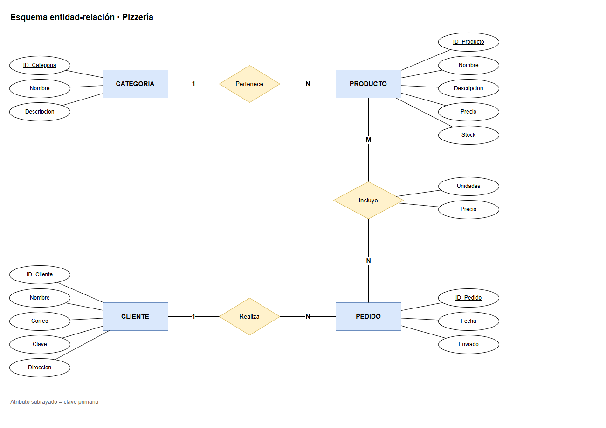
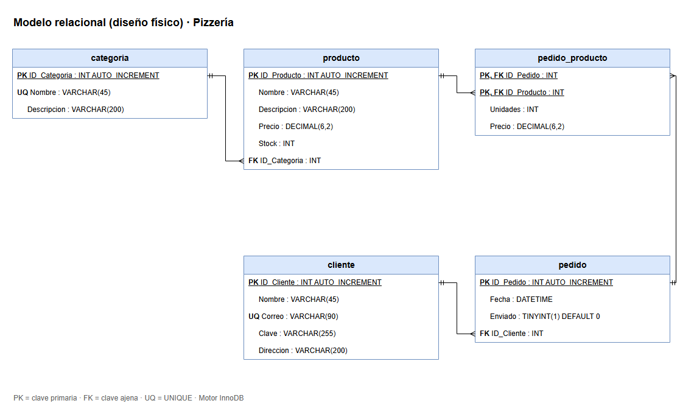
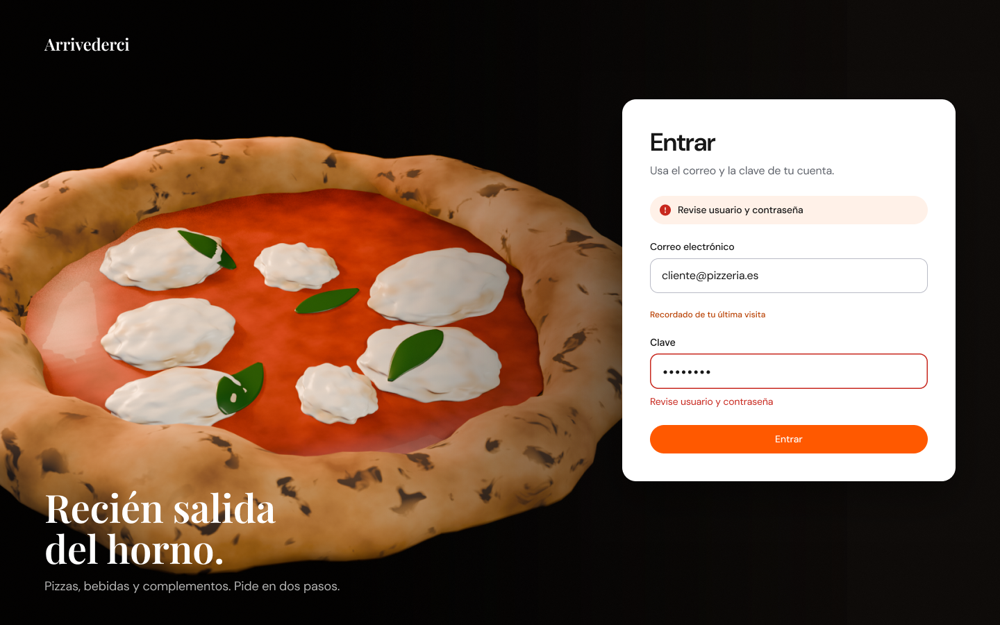
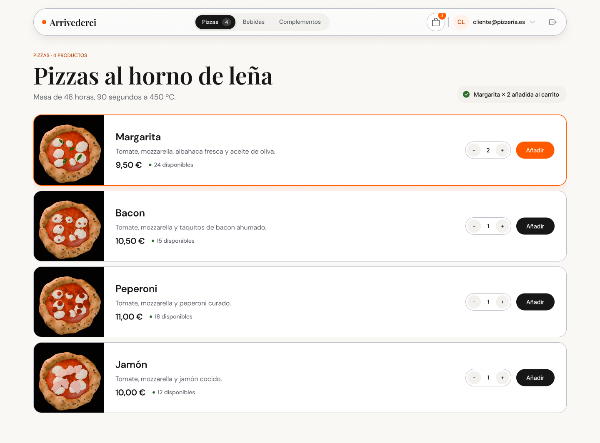
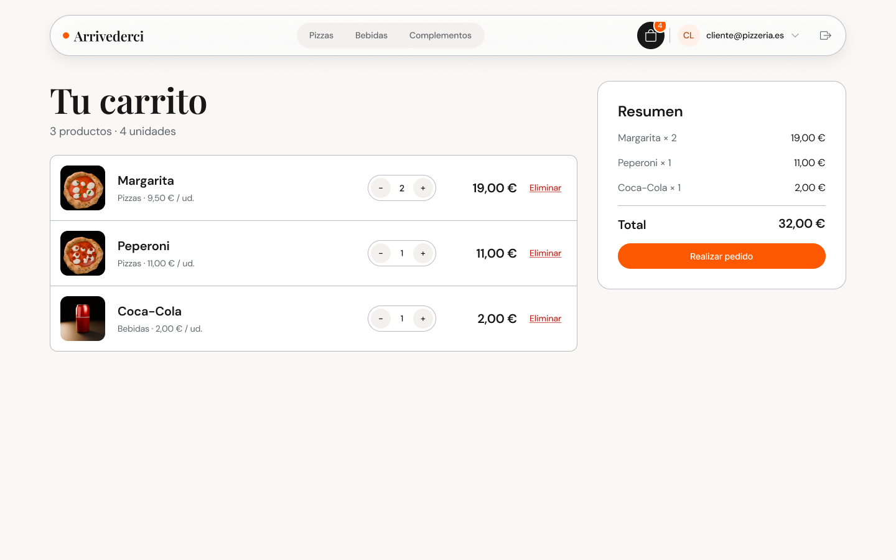
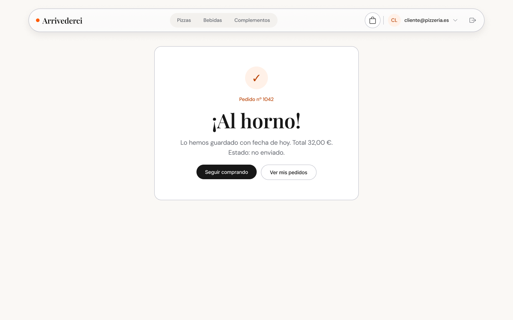

# ERS · Arrivederci · Borrador

## 1. Introducción

### 1.1 Propósito

Definir de forma clara y comprobable los requisitos de Arrivederci, la tienda web de una pizzería. Este documento sirve de referencia para el diseño, la programación y las pruebas de la aplicación.

### 1.2 Alcance

La aplicación permite a los clientes de la pizzería consultar el catálogo, llenar un carrito y realizar pedidos a domicilio. El catálogo tiene 3 categorías con 8 productos cada una (24 en total):

| Categoría | Productos |
|---|---|
| Pizzas | Margarita, Bacon, Peperoni, Jamón, Cuatro quesos, Barbacoa, Hawaiana y Vegetal |
| Bebidas | Coca-Cola, Agua, Coca-Cola Zero, Fanta Naranja, Nestea, Agua con gas, Cerveza y Zumo de naranja |
| Complementos | Patatas fritas, Aros de cebolla, Alitas de pollo, Pan de ajo, Nuggets, Ensalada César, Patatas gajo y Tequeños |
 Se usa desde el navegador, en ordenador y en móvil.

### 1.3 Actores

| Actor | Permisos |
|---|---|
| Visitante | Ver la página de inicio y la pantalla de login. No ve datos de la tienda. |
| Cliente | Consultar categorías y productos, gestionar su carrito, realizar pedidos y consultar su historial. |
| Pizzería | No usa la aplicación. Da de alta clientes y productos, y marca los pedidos como enviados, directamente en la base de datos. |

## 2. Descripción general

### 2.1 Arquitectura

Aplicación web en tres capas:

- Navegador: páginas HTML con CSS. El JavaScript solo se usa para la decoración del inicio (RNF-06).
- Servidor: PHP 8 en XAMPP, con programación orientada a objetos. El carrito se guarda en la sesión y el último correo en una cookie.
- Base de datos: MySQL relacional con 5 tablas, accedida mediante PDO.

### 2.2 Suposiciones y restricciones

- No hay pago real. La simulación de pago con tarjeta queda para una etapa posterior.
- No hay autorregistro. Los clientes se dan de alta directamente en la base de datos.
- No hay panel de administración. Categorías, productos y precios se gestionan en la base de datos.
- No se controla el stock. El stock se muestra como dato, pero no bloquea la compra y un pedido no lo descuenta.
- No se pueden personalizar pizzas ("arma tu pizza"). Queda para una versión posterior.
- La dirección de entrega es la que figura en los datos del cliente.
- La aplicación funciona en local y, por ahora, no se despliega en un servidor público.

## 3. Requisitos funcionales

| ID | Requisito | Prioridad |
|---|---|---|
| RF-01 | Iniciar sesión con correo y clave. Si son incorrectos, se muestra un aviso. | Alta |
| RF-02 | Cerrar sesión desde cualquier página. Se vacía el carrito y se vuelve al login. | Alta |
| RF-03 | Consultar la lista de categorías: Pizzas, Bebidas y Complementos. | Alta |
| RF-04 | Consultar los productos de una categoría con nombre, descripción, precio y stock. | Alta |
| RF-05 | Añadir una o más unidades de un producto al carrito. | Alta |
| RF-06 | Consultar el carrito con los productos elegidos y sus unidades. | Alta |
| RF-07 | Mostrar el total del carrito: suma de precio × unidades de cada producto. | Media |
| RF-08 | Cambiar las unidades de un producto que ya está en el carrito. | Media |
| RF-09 | Eliminar un producto del carrito. | Alta |
| RF-10 | Realizar el pedido: se guarda en la base de datos con la fecha y el precio de cada línea. | Alta |
| RF-11 | Mostrar un mensaje de confirmación con el número de pedido tras realizarlo. | Media |
| RF-12 | Recordar el correo del último inicio de sesión mediante una cookie y rellenarlo en el login. | Baja |
| RF-13 | Cerrar la sesión automáticamente tras 15 minutos sin actividad. | Media |
| RF-14 | Consultar el historial de pedidos del cliente con fecha, total y estado de envío. | Baja |
| RF-15 | Mostrar una página de inicio pública que presenta la pizzería y enlaza con el login. | Baja |

## 4. Requisitos no funcionales

| ID | Tipo | Condición verificable |
|---|---|---|
| RNF-01 | Seguridad | Las claves de los clientes se guardan cifradas con `password_hash`, nunca en texto plano. |
| RNF-02 | Seguridad | Todas las consultas con datos del usuario usan sentencias preparadas (PDO `prepare`) para evitar la inyección SQL. |
| RNF-03 | Seguridad | Todo dato mostrado en pantalla pasa por `htmlspecialchars` para evitar la inyección de código (XSS). |
| RNF-04 | Control de acceso | Sin sesión iniciada, cualquier página privada redirige al login. |
| RNF-05 | Integridad | El pedido y sus líneas se guardan en una transacción: si falla una inserción, no se guarda nada. |
| RNF-06 | Mejora progresiva | Los elementos decorativos (vídeo de fondo del inicio y animaciones con GSAP) son opcionales. Con JavaScript desactivado o sin vídeo, todas las funciones de la tienda siguen funcionando. |

## 5. Casos de uso

### 5.1 Inventario

| Caso | Actor | Resultado | Requisitos |
|---|---|---|---|
| CU-01 Iniciar sesión | Cliente | Sesión iniciada | RF-01, RF-12, RNF-01 |
| CU-02 Añadir productos al carrito | Cliente | Carrito actualizado | RF-03, RF-04, RF-05, RF-06 |
| CU-03 Realizar pedido | Cliente | Pedido guardado | RF-07, RF-10, RF-11, RNF-05 |

### 5.2 CU-01: Iniciar sesión

Objetivo: entrar en la tienda. Disparador: el cliente abre la web. Precondición: el cliente existe en la base de datos. Postcondición: hay una sesión iniciada con los datos del cliente y un carrito vacío.

1. El sistema muestra el formulario de login. Si existe la cookie, rellena el correo.
2. El cliente escribe su correo y su clave y pulsa «Entrar».
3. El sistema busca el correo y comprueba la clave con `password_verify`.
4. El sistema crea la sesión, guarda el correo en una cookie y muestra las categorías.

Flujos alternativos: A1: correo o clave incorrectos → aviso «Revise usuario y contraseña» y el formulario conserva el correo. A2: el cliente intenta abrir una página privada sin sesión → redirección al login con el aviso «Haga login para continuar».

### 5.3 CU-02: Añadir productos al carrito

Objetivo: elegir productos y unidades. Disparador: el cliente pulsa una categoría. Precondición: sesión iniciada. Postcondición: el carrito de la sesión contiene el producto con las unidades indicadas.

1. El sistema muestra las categorías: Pizzas, Bebidas y Complementos.
2. El cliente elige una categoría.
3. El sistema muestra sus productos con nombre, descripción, precio y stock.
4. El cliente indica las unidades de un producto y pulsa «Añadir».
5. El sistema suma las unidades al carrito. Si el producto ya estaba, acumula las unidades.
6. El sistema muestra el carrito actualizado.

Flujos alternativos: A1: unidades vacías, cero o negativas → aviso y el carrito no cambia. A2: más de 15 minutos sin actividad → la sesión se cierra y se vuelve al login (RF-13).

### 5.4 CU-03: Realizar pedido

Objetivo: convertir el carrito en un pedido. Disparador: el cliente pulsa «Realizar pedido» en el carrito. Precondición: sesión iniciada y carrito con al menos un producto. Postcondición: existe un pedido no enviado con sus líneas, y el carrito queda vacío.

1. El sistema muestra el carrito con el total.
2. El cliente pulsa «Realizar pedido».
3. El sistema abre una transacción.
4. El sistema inserta una fila en `pedido` con la fecha actual, `Enviado = 0` y el cliente.
5. El sistema inserta una fila en `pedido_producto` por cada producto, con unidades y precio actual.
6. El sistema confirma la transacción, vacía el carrito y muestra el número de pedido.

Flujos alternativos: A1: carrito vacío → el botón no aparece y se muestra «El carrito está vacío». A2: falla una inserción → se deshace la transacción, no se guarda nada y el carrito se conserva.

## 6. Reglas de negocio

| ID | Regla |
|---|---|
| RN-01 | Cada producto del carrito lleva entre 1 y 10 unidades. |
| RN-02 | Todo pedido nuevo se guarda como no enviado. La pizzería lo marca como enviado directamente en la base de datos. |
| RN-03 | Cada línea del pedido guarda el precio del producto en el momento de pedir. Los cambios de precio se hacen fuera del horario de atención, y la sesión caduca a los 15 minutos, así que ningún carrito abierto conserva un precio antiguo. |
| RN-04 | Solo se puede realizar un pedido si el carrito tiene al menos un producto. |
| RN-05 | El correo de cada cliente es único, porque es el usuario del login. |

## 7. Modelo de datos

### 7.1 Esquema entidad-relación

- Un cliente realiza muchos pedidos, y cada pedido es de un solo cliente (1:N).
- Una categoría tiene muchos productos, y cada producto pertenece a una sola categoría (1:N).
- Un pedido incluye muchos productos, y un producto aparece en muchos pedidos (N:M). La relación guarda las unidades y el precio.

### 7.2 Modelo relacional

| Tabla | Columnas | Claves |
|---|---|---|
| cliente | ID_Cliente, Nombre, Correo, Clave, Direccion | PK ID_Cliente · UNIQUE Correo |
| categoria | ID_Categoria, Nombre, Descripcion | PK ID_Categoria · UNIQUE Nombre |
| producto | ID_Producto, Nombre, Descripcion, Precio, Stock, ID_Categoria | PK ID_Producto · FK ID_Categoria → categoria |
| pedido | ID_Pedido, Fecha, Enviado, ID_Cliente | PK ID_Pedido · FK ID_Cliente → cliente |
| pedido_producto | ID_Pedido, ID_Producto, Unidades, Precio | PK (ID_Pedido, ID_Producto) · FK a pedido y a producto |

Las relaciones 1:N pasan la clave primaria del lado 1 como clave ajena al lado N. La relación N:M se resuelve con la tabla pedido_producto.

### 7.3 Diseño físico

- Las claves primarias son `INT AUTO_INCREMENT`, salvo en pedido_producto, que usa la pareja de claves ajenas.
- Los precios son `DECIMAL(6,2)` para guardar los céntimos exactos.
- `Enviado` es `TINYINT(1)` con valor por defecto 0 (RN-02).
- `Clave` es `VARCHAR(255)` para el resultado de `password_hash` (RNF-01).
- Las tablas usan el motor InnoDB, que comprueba las claves ajenas y permite transacciones (RNF-05).

## 8. Prototipos de la interfaz gráfica (Figma)

| Prototipo | Pantalla | Requisitos | Caso de uso |
|---|---|---|---|
| 8.1 | Inicio de sesión: correo (rellenado por la cookie), clave, botón «Entrar» y aviso de error | RF-01, RF-12 | CU-01 |
| 8.2 | Productos de una categoría: cabecera con usuario y carrito, tabla de productos con unidades (1 a 10) y botón «Añadir» | RF-03, RF-04, RF-05 | CU-02 |
| 8.3 | Carrito: productos, unidades editables, botón «Eliminar», total y botón «Realizar pedido» | RF-06 a RF-11 | CU-03 |
| 8.4 (opcional) | Inicio público con vídeo de fondo exportado de Blender y animación con GSAP | RF-15, RNF-06 | Ninguno |

### 8.1 Inicio de sesión (RF-01, RF-12)

### 8.2 Productos de una categoría (RF-03, RF-04, RF-05)

### 8.3 Carrito (RF-06 a RF-10)

### 8.3b Confirmación del pedido (RF-11)

## 9. Pruebas de aceptación

Las pruebas se escriben ahora y se harán a mano en el navegador cuando la aplicación esté lista.

| Prueba | Requisito | Qué se hace | Qué debe pasar | Estado |
|---|---|---|---|---|
| CP-01 | RF-01 | Entrar con una clave equivocada. | Sale un aviso de error y el correo sigue escrito. | Pendiente |
| CP-02 | RNF-04 | Abrir la página de productos sin haber entrado. | La web te devuelve al login. | Pendiente |
| CP-03 | RF-05 / RN-01 | Añadir 11 pizzas iguales al carrito. | Sale un aviso y el carrito no cambia. | Pendiente |
| CP-04 | RF-10 / RNF-05 | Pedir 2 Margaritas y 1 Coca-Cola. | En la base aparece 1 pedido nuevo, sin enviar, con sus 2 líneas. | Pendiente |
| CP-05 | RF-13 | Entrar y no tocar nada durante 15 minutos. | Al pulsar cualquier enlace, la web te devuelve al login. | Pendiente |

## 10. Matriz de trazabilidad

Relaciona los requisitos principales con su caso de uso, su prueba y su prototipo.

| Requisito | Caso de uso | Prueba | Prototipo |
|---|---|---|---|
| RF-01 | CU-01 | CP-01 | 8.1 |
| RF-05 | CU-02 | CP-03 | 8.2 |
| RF-10 | CU-03 | CP-04 | 8.3 |
| RF-13 | CU-02 | CP-05 | Sin prototipo |
| RNF-04 | CU-01 | CP-02 | 8.1 |
| RNF-05 | CU-03 | CP-04 | 8.3 |
